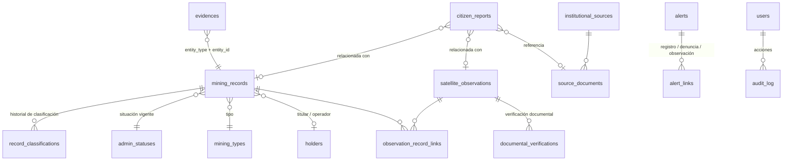

# Fase 3 — Modelo de datos

Fuente de verdad: [`backend/db/migrations/001_init.sql`](../backend/db/migrations/001_init.sql) (PostgreSQL + PostGIS, esquema `geoalerta`).
Espejo en el frontend: [`src/types/domain.ts`](../src/types/domain.ts).

## 1. Entidades y relaciones

| # | Entidad (requisito) | Tabla(s) | Notas |
|---|---|---|---|
| 1 | Registros mineros | `mining_records`, vista `v_mining_records` | ID `GA-MIN-000001`; eliminación lógica; versión para control de concurrencia |
| 2 | Coordenadas y geometrías | `geom` (Point, generado desde lat/lng), `area_geom` (MultiPolygon) | EPSG:4326; `area_ha` calculada con `ST_Area(geography)`; índices GiST |
| 3 | Titulares y operadores | `holders` | Deduplicados por nombre normalizado; `holder_type` y `tax_id` (NIT) opcionales |
| 4 | Situación administrativa | `admin_statuses` + `record_classifications` | Cada cambio conserva institución, documento, fecha de consulta, estado de verificación, autor y fecha |
| 5 | Tipos de minería | `mining_types` | Catálogo ampliable sin cambiar código |
| 6 | Denuncias | `citizen_reports` | Contacto **cifrado** (`contact_info_encrypted`); código de seguimiento no secuencial |
| 7 | Observaciones satelitales | `satellite_observations`, `documental_verifications`, `observation_record_links` | `origin` = automatizada / interpretación manual, separado de la verificación documental |
| 8 | Fuentes institucionales | `institutional_sources`, `source_documents` | `availability` = integración pendiente / carga manual / servicio conectado / no disponible |
| 9 | Evidencias documentales | `evidences` | Archivo fuera de la BD (`storage_key`), con SHA-256 para verificar integridad |
| 10 | Usuarios y roles | `users` (`role`), `revoked_tokens` | bcrypt; bloqueo tras intentos fallidos |
| 11 | Historial de modificaciones | `audit_log` | **Solo inserción** (un trigger impide UPDATE y DELETE); cambios campo a campo en `jsonb` |
| 12 | Alertas | `alerts`, `alert_links` | `derived_to` es obligatorio si el estado es «derivada» |

## 2. Reglas que la base de datos hace cumplir

La API también aplica estas reglas, pero la base de datos las garantiza aunque alguien la consulte directamente:

- **Sin respaldo no hay clasificación** (`ck_classification_support`): cualquier estado distinto de `sin_determinar` exige institución, documento y fecha de consulta.
- **«Ilegal verificada» exige verificación** (`ck_illegal_verified`).
- **Coordenadas dentro de Bolivia:** restricciones `CHECK` sobre lat/lng en todas las tablas con ubicación.
- **Geometría válida:** `ST_IsValid` sobre `area_geom`.
- **Código de derecho minero único** entre registros no eliminados (índice único parcial).
- **Una denuncia anónima no puede guardar contacto** (`ck_anon_no_contact`).
- **Bitácora inalterable:** trigger `tg_audit_immutable`.

## 3. Estado de definición: qué está decidido y qué conviene validar

El modelo cubre las 12 entidades pedidas y ya funciona de punta a punta (pantallas, API y SQL). Hay decisiones que dependen de **cómo son sus datos reales**. Conviene revisarlas antes de cargar información:

| Tema | Cómo está ahora | Qué necesitamos saber de ustedes |
|---|---|---|
| **Departamento / provincia / municipio** | Texto libre más una lista de referencia con 9 departamentos y 27 municipios | ¿Usarán los **códigos oficiales INE**? Lo recomendable es una tabla `divisiones_politicas` con código y polígono oficial, para validar y cruzar automáticamente |
| **Límites territoriales** | Polígonos aproximados, solo de referencia | Capas oficiales: límites del INE/IGM, áreas protegidas del SERNAP, cuadrículas de la AJAM (formato y vigencia) |
| **Código de derecho minero** | Texto, único | Formato oficial de la AJAM (¿patrón fijo? ¿una operación puede tener varias cuadrículas?). Si son varias, pasaría a una tabla `derechos_mineros` N:1 |
| **Titular** | Nombre más tipo y NIT opcionales | ¿Se identifican por NIT? ¿Hay cooperativas con varias concesiones? ¿Se registran representantes legales? (son datos personales con protección) |
| **Tipos de minería** | 7 categorías | ¿Se combinan? Por ejemplo, «aurífera aluvial». Hoy es una sola categoría por registro; podría pasar a etiquetas múltiples |
| **Mineral** | Texto libre | ¿Catálogo cerrado de minerales? |
| **Estados de denuncia** | Los 7 que pidieron | ¿Plazos máximos por estado (SLA) e instituciones receptoras oficiales? |
| **Observaciones satelitales** | Punto más superficie estimada; huella poligonal (`footprint`) prevista pero sin uso en la interfaz | ¿Recibirán resultados de un algoritmo (GeoTIFF/GeoJSON)? ¿Con qué periodicidad? ¿Quién los genera? |
| **Evidencias** | Disco local más SHA-256 | ¿Almacenamiento institucional (servidor de archivos, S3/MinIO)? ¿Tiempo de retención? |
| **Usuarios** | Contraseña local | ¿Hay directorio institucional (LDAP / Active Directory / SSO) para autenticarse? |
| **Volumen esperado** | Índices para decenas de miles de registros | Número aproximado de registros, denuncias por mes y usuarios simultáneos |

> **Recomendación:** antes de importar datos reales, compartan una muestra de 20 a 50 filas de cada fuente (aunque sea anonimizada). Con eso se ajustan los catálogos y las columnas de importación en una migración `002_*.sql` sin perder información.
